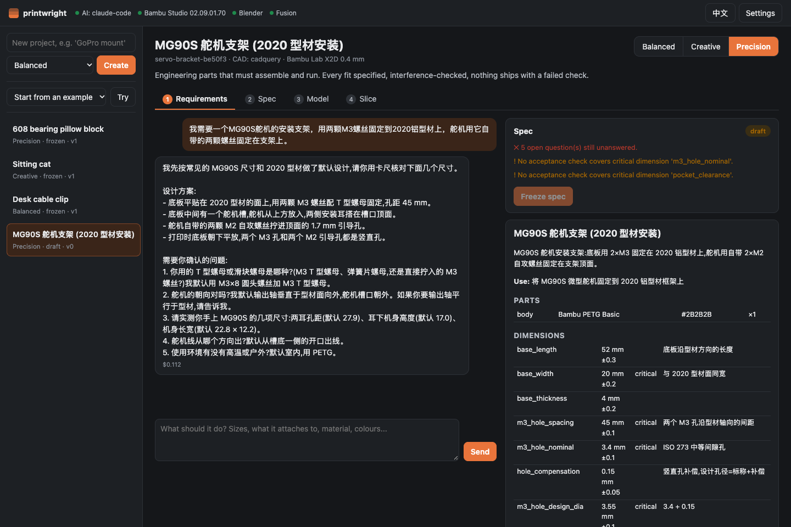
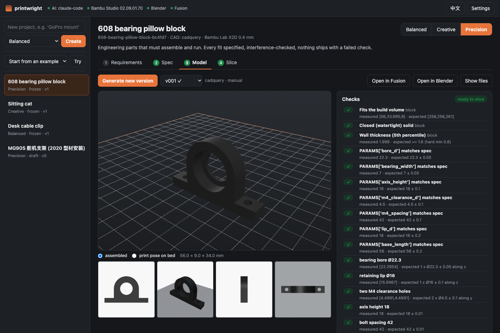
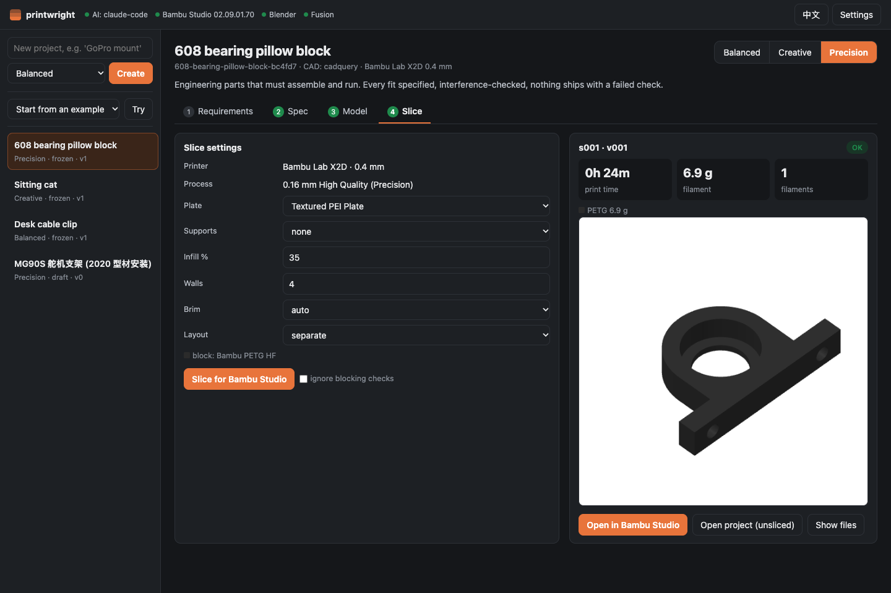

# printwright

**Describe a part, agree a precise spec, and get a checked, sliced 3MF for your Bambu Lab printer.**

[中文说明](README.zh-CN.md)

printwright is a local, open-source workbench that turns a conversation into a printable part:

```
requirements chat ──► frozen spec ──► CAD script ──► build + checks ──► renders + review ──► Bambu Studio 3MF
     (LLM)            (you sign off)    (LLM)         (code, not LLM)     (LLM looks)          (CLI slicer)
                                          ▲                    │
                                          └── auto-repair ◄────┘   failures go back to the model
```

It runs on your machine and uses **Claude Code** (your existing login), the **OpenAI API** or the **Anthropic API** as
the model. It drives the tools you already have: **CadQuery** for CAD, **Blender** for renders, **Autodesk Fusion** for
inspection and **Bambu Studio** for slicing. It was built for the Bambu Lab **X2D** and reads every printer fact (build
volume, the second nozzle's reach, filament presets) from Bambu Studio itself, so other Bambu printers work too.



> Not affiliated with Bambu Lab, Autodesk, the Blender Foundation, Anthropic or OpenAI. Names are used only to
> describe compatibility.

## Contents

- [Why spec-first](#why-spec-first)
- [Three design modes](#three-design-modes)
- [Install](#install)
- [Quick start: try an example in two minutes](#quick-start-try-an-example-in-two-minutes)
- [How to use it: your own part, step by step](#how-to-use-it-your-own-part-step-by-step)
- [Tips for good results](#tips-for-good-results)
- [Command line](#command-line)
- [Settings](#settings)
- [Where your files are](#where-your-files-are)
- [Writing or fixing models by hand](#writing-or-fixing-models-by-hand)
- [Troubleshooting](#troubleshooting)
- [Safety](#safety) · [Development](#development)

## Why spec-first

Asking a model for "a GoPro mount" gets you *a* mount. printwright first makes the requirements explicit (sizes,
tolerances, fits, hardware, materials, orientation, how success is measured). You freeze that spec, and it becomes the
test oracle. Every generated model is measured by plain geometry code: bounding box, hole diameters from
cross-sections, wall thickness by ray casting, overhangs, bed contact, printer fit, and part overlap in the assembled
pose. Nothing is trusted just because the model said so.

## Three design modes

| | **Balanced** (default) | **Creative** | **Precision** |
|---|---|---|---|
| For | everyday functional prints: holders, boxes, brackets | figurines, toys, decorative and organic shapes | robotics, mechanisms, parts that must assemble and run |
| Who decides details | the platform picks tolerances and settings, and suggests another mode when it fits better | style, size and colours matter; millimetres don't | you: nothing is left vague |
| CAD | CadQuery (exact B-rep, STEP export) | organic SDF modelling → smooth watertight mesh, flush multi-colour inlays | CadQuery only |
| Spec must have | a clearance for every fit | an overall size | toleranced critical dimensions, nominal size + clearance for every fit, purchased hardware with exact dimensions, no open questions |
| Checks that block slicing | build, printer fit, watertight, hard-minimum walls, part overlap | build, printer fit, watertight | all of those **plus every failed acceptance check** and any PARAMS / spec mismatch |
| Default slicing | 0.20 mm Standard, 3 walls, 15 % gyroid | 0.12 mm High Quality, 2 walls, tree supports | 0.16 mm High Quality, 4 walls, 35 % gyroid |

Switch modes any time with the switch at the top right of a project. The spec goes back to draft so you re-confirm it
under the new rules.

## Install

You need:

* **Python 3.10–3.13** and [uv](https://docs.astral.sh/uv/) (or plain pip).
* **[Bambu Studio](https://bambulab.com/en/download/studio) 2.0 or newer.** printwright uses its presets and its
  command-line slicer. Open it once so it downloads the latest printer profiles.
* **One model provider** (see below). Not needed for the examples.
* Optional: **Blender** for nicer renders (otherwise matplotlib is used) and **Autodesk Fusion** to inspect STEP files.

```bash
git clone https://github.com/kzhou003/printwright.git
cd printwright
uv sync --all-extras          # or: python -m venv .venv && .venv/bin/pip install -e '.[all]'
uv run printwright doctor     # lists what was found: Bambu Studio, Blender, Fusion, providers
uv run printwright serve      # opens http://127.0.0.1:8765 in your browser
```

`uv run` runs commands inside the project's environment; after `source .venv/bin/activate` you can type
`printwright ...` directly.

Platforms: developed and tested on macOS (Apple Silicon) with Bambu Studio 2.09, Blender 5.3 and Fusion. The test
suite also runs on Linux in CI. Windows paths are handled but not yet tested; reports are welcome. On Apple Silicon
the environment should be arm64 (`uv` picks it automatically; from a Rosetta terminal use `arch -arm64 uv sync`).

### Model providers

| Provider | Setup | Notes |
|---|---|---|
| `claude-code` (default) | install [Claude Code](https://claude.com/claude-code) and log in once with `claude` | Uses your existing Claude login, no API key. Runs `claude -p` with printwright's own prompt, no MCP servers and no tools except reading render images. A spec turn costs about $0.02–0.15, a model generation $0.25–1. |
| `openai` | `export OPENAI_API_KEY=...` | Responses API. Set `openai_model` in Settings. |
| `anthropic` | `export ANTHROPIC_API_KEY=...` or `ant auth login` | Streams with adaptive thinking. Default model `claude-opus-5-5`. |

Pick one in the web UI (**Settings**, top right) or on the command line: `uv run printwright config provider openai`.

## Quick start: try an example in two minutes

No AI account needed. Each example comes with a frozen spec and a script, so you can see the whole pipeline at once.

1. `uv run printwright serve`
2. In the left sidebar, open **Start from an example**, pick one and click **Try**:
   * **Desk cable clip** (balanced): snaps onto a 19 mm desk edge, holds three cables.
   * **Sitting cat** (creative): orange cat with a flush white belly inlay, two colours.
   * **608 bearing pillow block** (precision): bore, retaining lip and two M4 holes, all measured.
3. The **Model** tab opens: rotate the 3D view, switch between *assembled* and *print pose on bed*, and read the
   checks on the right. Every check shows what was measured and what the spec expected.



4. Go to **Slice** and click **Slice for Bambu Studio**. After a few seconds you see print time, filament weight
   and a plate preview. Click **Open in Bambu Studio** to print.



From the terminal it is the same:

```bash
uv run printwright example                  # list the examples
uv run printwright example bearing-block    # build, check and render it
uv run printwright list                     # shows the new project id
uv run printwright slice 608-bearing        # any unique prefix of the id works
uv run printwright open 608-bearing bambu   # opens the sliced file in Bambu Studio
```

## How to use it: your own part, step by step

### 1. Create a project and choose a mode

Type a name in the sidebar (for example *GoPro handlebar mount*), choose **Balanced**, **Creative** or **Precision**
and click **Create**. If you are unsure, keep Balanced; the assistant will suggest another mode if your part needs it,
and a banner lets you switch with one click.

### 2. Describe what you need (Requirements tab)

Write as you would to a designer, in any language. Useful things to mention:

* **What it does and what it touches**: "holds a 75 mm wide phone on a 22 mm handlebar".
* **Sizes you know**, and which ones are critical. Measure real parts with calipers when you can.
* **Purchased parts** it must fit: screws (M3 × 10), heat-set inserts, bearings (608), magnets (6 × 3 mm), servos.
* **Where it lives**: indoors, in a car in summer, outdoors in the sun, food contact. This decides the material.
* **Looks** (creative mode): style, pose, colours, overall height.

The assistant answers with a short summary and at most a few questions. On the right it keeps the **complete spec**:
parts and filaments, dimensions, fits, hardware, assumptions, open questions, and the acceptance checks that will
be measured later. Red items block freezing; yellow ones are worth a look. Keep chatting until the spec is right:
answer its questions, or say "use sensible defaults" and review its assumptions.

### 3. Freeze the spec (Spec tab)

The **Spec** tab shows the spec as JSON if you want to edit numbers directly. When it is right, click
**Freeze spec**. Freezing is the contract: the CAD is generated from it and checked against it. Precision mode
refuses to freeze while a critical dimension lacks a tolerance, a fit lacks a clearance, a hardware item lacks
dimensions, or a question is still open. Talking about requirements again unfreezes it.

### 4. Generate and review the model (Model tab)

Click **Generate model**. A progress panel shows each step: writing the script, building it, measuring it,
repairing failures automatically (up to 3 extra rounds), rendering four views and the visual review. This takes from
about a minute to several minutes depending on the model.

Then judge the result:

* **3D view**: drag to rotate, scroll to zoom. *Print pose on bed* shows how each part lies on the plate.
* **Checks**: green passed, yellow is a warning, red failed. A small ■ marks checks that block slicing.
* **Visual review**: the model looked at the renders and lists what does not match the spec or looks fragile.
* **Open in Fusion** opens the exact STEP file. **Open in Blender** opens the saved scene. **Show files** reveals
  the folder.

To improve it, write feedback ("make the wall 3 mm", "move the hole 5 mm left", "rounder ears") and click
**Revise**, or click **Revise with these findings** to apply the review. Each revision is a new version (v002, v003, ...)
and you can switch between versions with the dropdown. You can also edit the script under **CAD script** and click
**Save and rebuild**, which runs the build and checks without any AI.

### 5. Slice and print (Slice tab)

Choose the plate, supports, infill, walls, brim and layout. The defaults come from the mode, and printer and filament
presets come from Bambu Studio. Click **Slice for Bambu Studio**. You get two files:

* `<name>.gcode.3mf`: sliced and ready. **Open in Bambu Studio** shows it in the preview; send it to the printer from
  there.
* `<name>.3mf`: the same project, not sliced. **Open project (unsliced)** lets you change settings in Bambu Studio and
  slice it yourself.

If checks still block slicing you can tick *ignore blocking checks*. The slice is then marked *forced*. In precision
mode, fix the cause instead.

**Before printing a precision part**, print the fit-test coupon if the spec includes one, or print just the critical
feature first. Every printer and filament prints holes slightly differently. Adjust the compensation parameter in
the spec and regenerate.

## Tips for good results

* **Measure, don't guess.** In precision mode, measure your screws, bearings and servos with calipers and give those
  numbers; datasheet values are often 0.1–0.3 mm off from the real part.
* **Name the critical dimensions.** "The bore must fit a 608 bearing" is better than "a 22 mm hole". The assistant
  then adds the clearance and the hole compensation and writes a hole check for it.
* **Say where it will be used.** PLA softens around 55 °C; a car in summer needs PETG, ABS or ASA.
* **Creative mode: give a size and a style.** "60 mm tall, chubby, two colours" is enough to start. Keep to two
  colours on the X2D unless you have an AMS; more colours mean filament changes and purge waste.
* **Revise in small steps.** One or two changes per revision makes it easy to see what helped.
* **Cost and speed.** With Claude Code, set *claude_code_model* to `sonnet` or *claude_code_effort* to `medium` in
  Settings for faster, cheaper runs; keep the defaults for hard precision parts.

## Command line

Everything in the web UI also works from the terminal:

```bash
printwright new "MG90S bracket" --mode precision
printwright chat mg90s "Mount an MG90S servo on 2020 extrusion with two M3 screws"
printwright spec mg90s                 # show the spec and what still blocks freezing
printwright spec mg90s --freeze
printwright generate mg90s
printwright report mg90s               # the check list
printwright generate mg90s -f "make the base 1 mm thicker"
printwright rebuild mg90s              # after editing iterations/vNNN/model.py yourself
printwright import mg90s my_model.py   # bring your own script, no AI
printwright mode mg90s balanced        # switch mode
printwright slice mg90s
printwright open mg90s bambu           # or: fusion | blender | reveal
printwright modes                      # what each mode does
printwright doctor                     # what was found on this machine
```

Project ids can be shortened to any unique prefix.

## Settings

Change them in the web UI (**Settings**) or with `printwright config <key> <value>`. They are stored in
`~/Printwright/settings.json`.

| Key | Default | Meaning |
|---|---|---|
| `provider` | `claude-code` | `claude-code`, `openai` or `anthropic` |
| `claude_code_model` / `claude_code_effort` | CLI default | e.g. `sonnet` / `medium` for faster runs |
| `claude_code_max_budget_usd` | `5.0` | spend cap per Claude Code call |
| `openai_model`, `openai_reasoning_effort` | `gpt-5.1`, `medium` | OpenAI model settings |
| `anthropic_model`, `anthropic_effort` | `claude-opus-5-5`, `high` | Anthropic API settings |
| `max_repair_attempts` | `3` | automatic repair rounds after build or check failures |
| `vision_review` | `true` | let the model review the renders |
| `renderer` | `auto` | `blender` when installed, otherwise `matplotlib` |
| `cad_backend` | `cadquery` | default backend in balanced mode |
| `bambu_studio_path`, `blender_path` | auto-detected | set these if the apps are in unusual places |

Set `PRINTWRIGHT_HOME` to keep projects somewhere other than `~/Printwright`.

## Where your files are

Everything is plain files, easy to back up or put under version control:

```
~/Printwright/projects/<id>/
  project.json, spec.md             chat, spec, history
  iterations/v001/
    model.py                        the CAD script (edit it and rebuild)
    prompt.md                       exactly what was sent to the model
    build/parts/*.step|stl          parts in print pose; build/assembly.step: the assembly
    renders/*.png, scene.blend      four views and a Blender scene
    report.json, review.json        checks and visual review
  slices/s001/
    <name>.gcode.3mf, <name>.3mf    sliced file and editable project
    presets/*.json, slice.log       the exact Bambu Studio settings used
```

More detail in [docs/architecture.md](docs/architecture.md).

## Writing or fixing models by hand

Scripts follow a small contract, so you can write or fix them yourself:

```python
import cadquery as cq

PARAMS = {"length": 60.0, "width": 40.0, "height": 20.0, "wall": 2.0}   # names match the spec
PRINT_POSE = {"lid": {"rotate": [180, 0, 0]}}                            # optional, per part

def build(p):
    base = (cq.Workplane().box(p["length"], p["width"], p["height"], centered=(True, True, False))
            .faces(">Z").shell(-p["wall"]))
    return {"base": base}          # parts in their assembled position, keyed by spec part name
```

Creative mode uses `printwright.cad.organic` (signed distance fields with smooth blends, and `mesh_parts` for flush
multi-colour inlays). See [docs/modelling.md](docs/modelling.md) and the examples in
[src/printwright/examples](src/printwright/examples).

## Troubleshooting

| Problem | What to do |
|---|---|
| `doctor` shows Bambu Studio missing | Install it, or set `bambu_studio_path`. |
| "No filament preset named ... is compatible" | Use a filament family listed in the error, or update Bambu Studio's profiles (open it once while online). |
| "cannot be printed on the Cool Plate" | Choose another plate in the Slice tab; PETG and PLA together work on Textured PEI. |
| Generation fails after all repair rounds | Read the last error in the progress panel, simplify the request, or fix `model.py` and **Save and rebuild**. |
| Claude Code errors or hits the budget | Run `claude` once to log in; raise `claude_code_max_budget_usd`. |
| Renders look plain | Install Blender; printwright falls back to matplotlib without it. |
| A precision fit is too tight or loose | Measure the print, change the clearance or compensation in the spec, regenerate. |

## Safety

Model-written scripts run on your computer. printwright rejects scripts that import anything beyond geometry and
maths libraries, call dynamic-execution built-ins or write files. It then runs them in a separate process with a time
limit and without API keys in the environment. That is defence in depth, **not a sandbox**: read
[SECURITY.md](SECURITY.md). The web server listens on 127.0.0.1 only and rejects cross-site requests.

## Development

```bash
uv sync --all-extras
uv run pytest            # offline; tests needing Bambu Studio or Blender skip when absent
uv run ruff check src tests && uv run ruff format --check src tests
```

See [CONTRIBUTING.md](CONTRIBUTING.md) and [CHANGELOG.md](CHANGELOG.md). Licensed under the [MIT License](LICENSE).
The bundled three.js files are MIT licensed (see `src/printwright/static/vendor/LICENSE-three.txt`).
