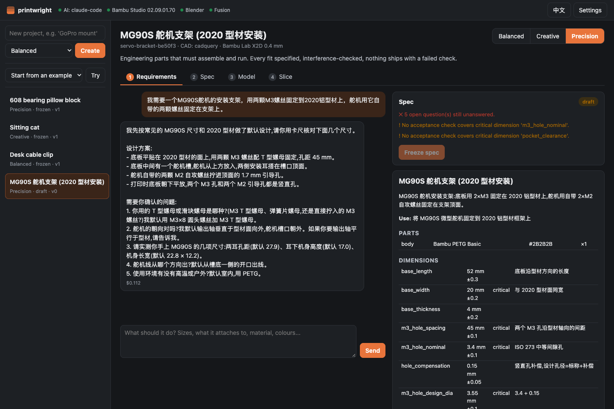
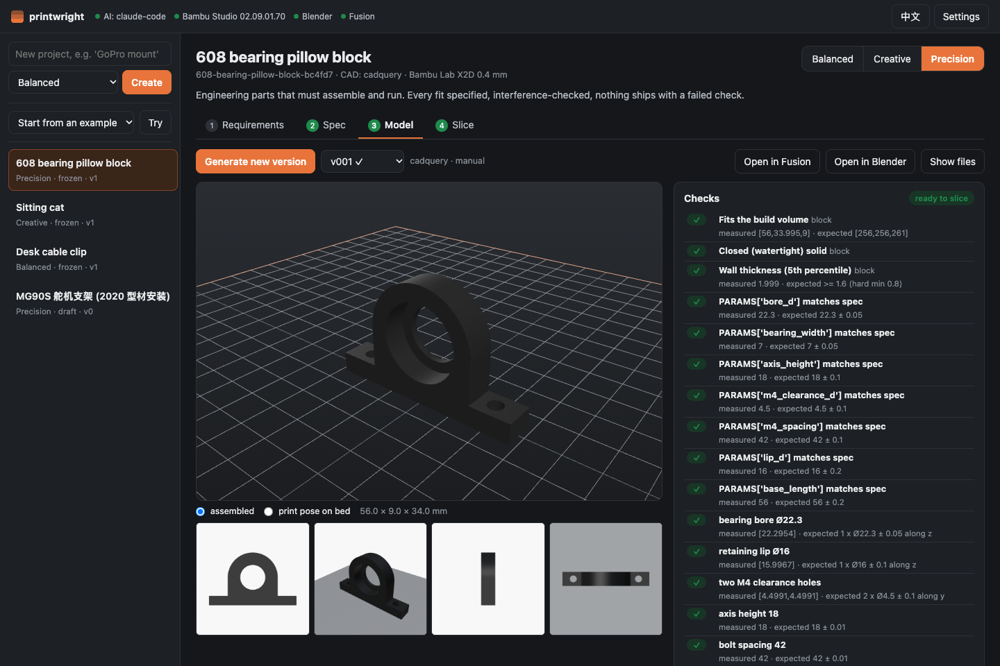
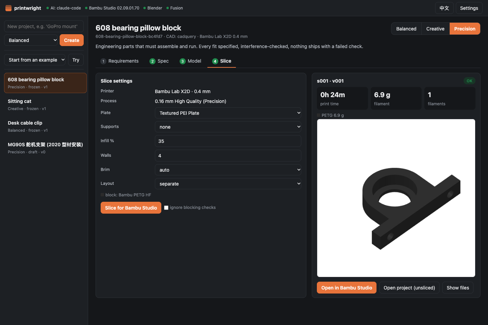

# printwright

**说清需求，定好规格，拿到检查过、切好片的 Bambu 3MF。**

[English](README.md)

printwright 是一个本地运行的开源工作台，把一段对话变成能打印的零件：

```
需求对话 ──► 冻结规格 ──► CAD 脚本 ──► 构建与检查 ──► 渲染与审查 ──► Bambu Studio 3MF
  (LLM)       (你确认)      (LLM)       (代码测量)      (LLM 看图)      (命令行切片)
                             ▲               │
                             └── 自动修复 ◄──┘   检查失败会交回模型修改
```

模型可以用 **Claude Code**（沿用你已登录的账号）、**OpenAI API** 或 **Anthropic API**。CAD 用 **CadQuery**，
渲染用 **Blender**，可以在 **Autodesk Fusion** 里打开 STEP 检查，切片用 **Bambu Studio**。它为 Bambu Lab
**X2D** 打造，但打印机参数（构建体积、第二喷嘴的可达范围、耗材预设）全部从 Bambu Studio 自带的预设读取，
其他 Bambu 机型也能用。



> 与 Bambu Lab、Autodesk、Blender 基金会、Anthropic、OpenAI 均无关联，提到它们只是说明兼容性。

## 为什么先定规格

直接让模型做“一个 GoPro 支架”，你会得到*某个*支架。printwright 先把需求说清楚：尺寸、公差、配合、外购件、
材料、打印方向，以及怎样才算合格。你冻结规格后，它就是验收标准。每个生成的模型都由几何代码测量：外形尺寸、
截面测孔径、射线测壁厚、悬垂面积、贴床面积、能否放进打印机、装配位置下零件是否重叠。不会因为模型“说可以”就放行。

## 三种模式

| | **均衡 Balanced**（默认） | **创意 Creative** | **精密 Precision** |
|---|---|---|---|
| 适合 | 日常功能件：收纳、盒子、支架 | 玩偶、摆件、装饰、有机造型 | 机器人、机构、必须能装配运转的零件 |
| 细节谁定 | 平台选公差和参数，更适合别的模式时会提示 | 造型、大小、颜色要紧，毫米级不要紧 | 你来定，什么都不能含糊 |
| 建模 | CadQuery（精确 B-rep，可导出 STEP） | 有机 SDF 建模，平滑水密网格，多色平齐镶嵌 | 只用 CadQuery |
| 冻结前必须有 | 每处配合写明间隙 | 整体尺寸 | 关键尺寸带公差，每处配合有名义尺寸和间隙，外购件写明精确尺寸，没有未答问题 |
| 阻止切片的检查 | 构建失败、放不进打印机、不水密、壁厚低于硬下限、零件重叠 | 构建失败、放不进打印机、不水密 | 前面全部，**外加任何一项验收检查失败**，以及 PARAMS 与规格不符 |
| 默认切片 | 0.20 mm Standard，3 圈墙，15% gyroid | 0.12 mm High Quality，2 圈墙，树状支撑 | 0.16 mm High Quality，4 圈墙，35% gyroid |

项目右上角可以随时切换模式。切换后规格回到草稿，需要按新规则重新确认。

## 安装

需要：

* **Python 3.10–3.13** 和 [uv](https://docs.astral.sh/uv/)（也可以用 pip）。
* **[Bambu Studio](https://bambulab.com/en/download/studio) 2.0 以上**。printwright 用它的预设和命令行切片器。先打开一次，让它下载最新的打印机配置。
* **一种模型**（见下表）。只跑示例的话不需要。
* 可选：**Blender**（渲染更好看，没有就用 matplotlib）和 **Autodesk Fusion**（检查 STEP）。

```bash
git clone https://github.com/kzhou003/printwright.git
cd printwright
uv sync --all-extras
uv run printwright doctor     # 列出找到的 Bambu Studio、Blender、Fusion 和模型
uv run printwright serve      # 在浏览器打开 http://127.0.0.1:8765
```

`uv run` 表示在项目环境里运行；`source .venv/bin/activate` 之后可以直接输入 `printwright ...`。

平台：在 macOS（Apple Silicon）+ Bambu Studio 2.09 + Blender 5.3 + Fusion 上开发和测试，测试套件也在 Linux CI
上运行。Windows 的路径已处理，但还没实测。Apple Silicon 上请用 arm64 环境（Rosetta 终端里用 `arch -arm64 uv sync`）。

| 模型 | 设置 | 说明 |
|---|---|---|
| `claude-code`（默认） | 安装 Claude Code，运行一次 `claude` 登录 | 沿用你的 Claude 账号，不需要 API key。用 printwright 自己的提示调用 `claude -p`，不加载 MCP、不开放工具（看渲染图时只开 Read）。一轮规格对话约 $0.02–0.15，生成一次模型约 $0.25–1。 |
| `openai` | `export OPENAI_API_KEY=...` | Responses API，在设置里改 `openai_model` |
| `anthropic` | `export ANTHROPIC_API_KEY=...` 或 `ant auth login` | 流式 + 自适应思考，默认 `claude-opus-5-5` |

在网页右上角**设置**里切换，或者 `uv run printwright config provider openai`。

## 快速上手：两分钟跑一个示例

不需要 AI 账号。每个示例都带一份冻结好的规格和脚本，可以一次看完整个流程。

1. `uv run printwright serve`
2. 左侧栏选**从示例开始**，选一个，点**试用**：
   * **桌边理线夹**（均衡）：卡在 19 mm 桌边上，夹住三根线。
   * **坐着的小猫**（创意）：橘色身体、白色肚皮平齐镶嵌，双色。
   * **608 轴承座**（精密）：轴承孔、挡肩、两个 M4 孔，全部实测。
3. 自动打开**模型**页：可以旋转 3D 视图，在“装配位置”和“打印摆放”之间切换。右侧的检查列表会写明每一项测得多少、规格要求多少。



4. 到**切片**页，点**为 Bambu Studio 切片**。几秒后会显示打印时间、耗材重量和盘面预览。点**在 Bambu Studio 打开**就能打印。



命令行也一样：

```bash
uv run printwright example                  # 列出示例
uv run printwright example bearing-block    # 构建、检查、渲染
uv run printwright list                     # 查看新项目的 id
uv run printwright slice 608-bearing        # id 写出能唯一匹配的前缀即可
uv run printwright open 608-bearing bambu   # 在 Bambu Studio 打开切好的文件
```

## 怎么用：做你自己的零件

### 1. 新建项目，选模式

在左侧输入名字（比如“GoPro 车把支架”），选**均衡 / 创意 / 精密**，点**新建**。拿不准就用均衡，零件需要别的
模式时助手会建议，页面上会出现一条提示，点一下就能切换。

### 2. 描述需求（“需求”页）

像跟设计师说话一样写，中文英文都行。最好讲清楚：

* **它做什么、碰到什么**：“把 75 mm 宽的手机固定在 22 mm 的车把上”。
* **你知道的尺寸**，以及哪些是关键尺寸。能用卡尺量就量。
* **要配合的外购件**：螺丝（M3×10）、热熔螺母、轴承（608）、磁铁（6×3 mm）、舵机。
* **用在哪里**：室内、夏天的车里、户外暴晒、接触食物。这决定材料。
* **外观**（创意模式）：风格、姿势、颜色、整体高度。

助手会简短总结，最多问几个关键问题。右侧随时显示**完整规格**：零件和耗材、尺寸、配合、外购件、假设、未答问题，
以及之后要实测的验收检查。红色项会阻止冻结，黄色项值得看一眼。继续对话直到规格正确：回答它的问题，或者说
“按合理默认值来”，再检查它列出的假设。

### 3. 冻结规格（“规格”页）

“规格”页可以直接改 JSON 里的数字。确认无误后点**冻结规格**。冻结就是签契约：CAD 按它生成，也按它检查。
精密模式下，只要还有关键尺寸没写公差、配合没写间隙、外购件没写尺寸或问题没答完，就不能冻结。之后再聊需求会自动解冻。

### 4. 生成并审查模型（“模型”页）

点**生成模型**。进度面板会显示每一步：写脚本、构建、测量、自动修复（最多再修 3 轮）、渲染四个视角、视觉审查。
根据所用模型，大约一分钟到几分钟。

然后看结果：

* **3D 视图**：拖动旋转，滚轮缩放。“打印摆放”显示每个零件怎么躺在热床上。
* **检查**：绿色通过，黄色警告，红色失败。带 ■ 的是会阻止切片的项。
* **视觉审查**：模型看了渲染图，列出和规格不符或者容易坏的地方。
* **在 Fusion 打开**会打开精确的 STEP；**在 Blender 打开**会打开保存的场景；**显示文件**打开所在文件夹。

要改进的话，写下修改意见（“壁厚改成 3 mm”“孔左移 5 mm”“耳朵更圆”）后点**修改**，或者点**按审查意见修改**。
每次修改都是一个新版本（v002、v003……），可以用下拉框切换。也可以直接改下方的 **CAD 脚本**，点
**保存并重建**，只跑构建和检查，不调用 AI。

### 5. 切片和打印（“切片”页）

选热床板、支撑、填充、墙数、裙边和布局。默认值来自当前模式，打印机和耗材预设来自 Bambu Studio。
点**为 Bambu Studio 切片**，会得到两个文件：

* `<名字>.gcode.3mf`：已切片。**在 Bambu Studio 打开**会进入预览，从那里发送到打印机。
* `<名字>.3mf`：同一个工程但未切片。**打开工程（未切片）**可以在 Bambu Studio 里调参数后自己切。

如果还有阻断项，可以勾选“忽略阻断性检查”，切片会标记为 *forced*。精密模式下建议先解决问题。

**打印精密零件之前**，如果规格里有配合测试块，先打它；没有的话先只打关键部位。不同打印机和耗材打出来的孔径
都略有差别，按实测结果调整规格里的补偿参数后重新生成。

## 获得好结果的建议

* **量，别猜。** 精密模式下用卡尺量你手上的螺丝、轴承、舵机。规格书上的数值和实物经常差 0.1–0.3 mm。
* **说清关键尺寸的用途。** “孔要装 608 轴承”比“22 mm 的孔”好，助手会自己加间隙和孔径补偿，并写好孔径检查。
* **说清使用环境。** PLA 大约 55 °C 就会变软，夏天放车里要用 PETG、ABS 或 ASA。
* **创意模式给尺寸和风格。** “高 60 mm、胖乎乎、两种颜色”就够开始了。X2D 没有 AMS 时尽量两色，更多颜色意味着换料和冲刷浪费。
* **一次改一两处。** 方便看出哪次修改起了作用。
* **费用和速度。** 用 Claude Code 时，可以在设置里把 *claude_code_model* 设为 `sonnet`、或 *claude_code_effort* 设为 `medium`，更快更省；难的精密零件保持默认。

## 命令行

网页上的操作都可以在终端完成：

```bash
printwright new "MG90S 支架" --mode precision
printwright chat mg90s "把 MG90S 舵机用两颗 M3 螺丝固定到 2020 型材上"
printwright spec mg90s                 # 查看规格和阻止冻结的原因
printwright spec mg90s --freeze
printwright generate mg90s
printwright report mg90s               # 检查列表
printwright generate mg90s -f "底板加厚 1 mm"
printwright rebuild mg90s              # 自己改了 iterations/vNNN/model.py 之后
printwright import mg90s my_model.py   # 导入自己的脚本，不用 AI
printwright mode mg90s balanced        # 切换模式
printwright slice mg90s
printwright open mg90s bambu           # 或 fusion | blender | reveal
printwright modes                      # 三种模式的说明
printwright doctor                     # 本机找到了什么
```

## 设置

在网页的**设置**里改，或者 `printwright config <键> <值>`，保存在 `~/Printwright/settings.json`。

| 键 | 默认 | 含义 |
|---|---|---|
| `provider` | `claude-code` | `claude-code`、`openai` 或 `anthropic` |
| `claude_code_model` / `claude_code_effort` | CLI 默认 | 例如 `sonnet` / `medium`，更快 |
| `claude_code_max_budget_usd` | `5.0` | 每次调用 Claude Code 的花费上限 |
| `max_repair_attempts` | `3` | 构建或检查失败后自动修复的轮数 |
| `vision_review` | `true` | 让模型审查渲染图 |
| `renderer` | `auto` | 装了 Blender 就用它，否则用 matplotlib |
| `bambu_studio_path`、`blender_path` | 自动查找 | 软件装在特殊位置时设置 |

设置环境变量 `PRINTWRIGHT_HOME` 可以把项目放到 `~/Printwright` 以外的地方。

## 文件在哪里

全部是普通文件，方便备份或用 git 管理：

```
~/Printwright/projects/<id>/
  project.json, spec.md             对话、规格、历史
  iterations/v001/
    model.py                        CAD 脚本（可以改了再重建）
    prompt.md                       发给模型的完整内容
    build/parts/*.step|stl          打印摆放的零件；build/assembly.step 是装配体
    renders/*.png, scene.blend      四个视角和 Blender 场景
    report.json, review.json        检查结果和视觉审查
  slices/s001/
    <名字>.gcode.3mf, <名字>.3mf     切好的文件和可编辑工程
    presets/*.json, slice.log       实际使用的 Bambu Studio 参数
```

## 常见问题

| 问题 | 处理 |
|---|---|
| `doctor` 显示没有 Bambu Studio | 安装它，或者设置 `bambu_studio_path` |
| “No filament preset named ... is compatible” | 用报错里列出的耗材名，或者联网打开一次 Bambu Studio 更新配置 |
| “cannot be printed on the Cool Plate” | 在切片页换热床板；PLA 和 PETG 同盘用 Textured PEI |
| 修复轮数用完仍然失败 | 看进度面板里最后的报错，简化需求，或者自己改 `model.py` 后**保存并重建** |
| Claude Code 报错或超出预算 | 先运行一次 `claude` 登录；调高 `claude_code_max_budget_usd` |
| 精密配合太紧或太松 | 量打印件，在规格里改间隙或补偿值，重新生成 |

## 安全

模型写的脚本会在你的电脑上运行。printwright 会拒绝导入几何/数学库以外模块、调用动态执行函数或写文件的脚本，
再在独立进程里限时运行，并且不带 API 密钥。这是纵深防御，**不是沙箱**，详见 [SECURITY.md](SECURITY.md)。
网页服务只监听 127.0.0.1，并拒绝跨站请求。

## 开发

```bash
uv sync --all-extras
uv run pytest       # 离线运行；需要 Bambu Studio / Blender 的测试在没装时自动跳过
uv run ruff check src tests && uv run ruff format --check src tests
```

MIT 许可证。
